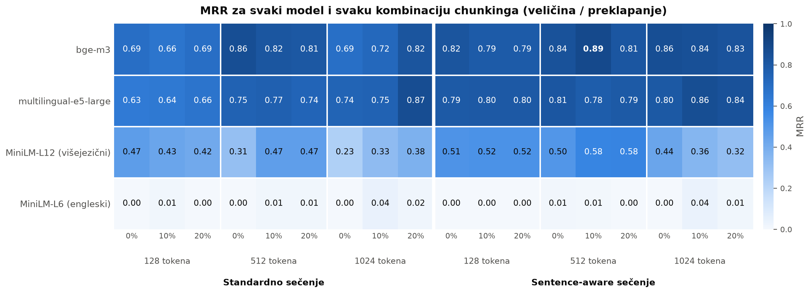
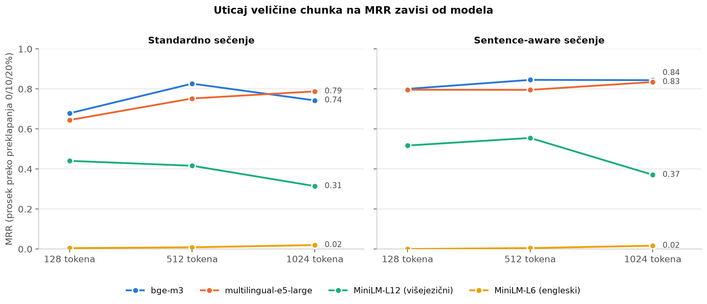
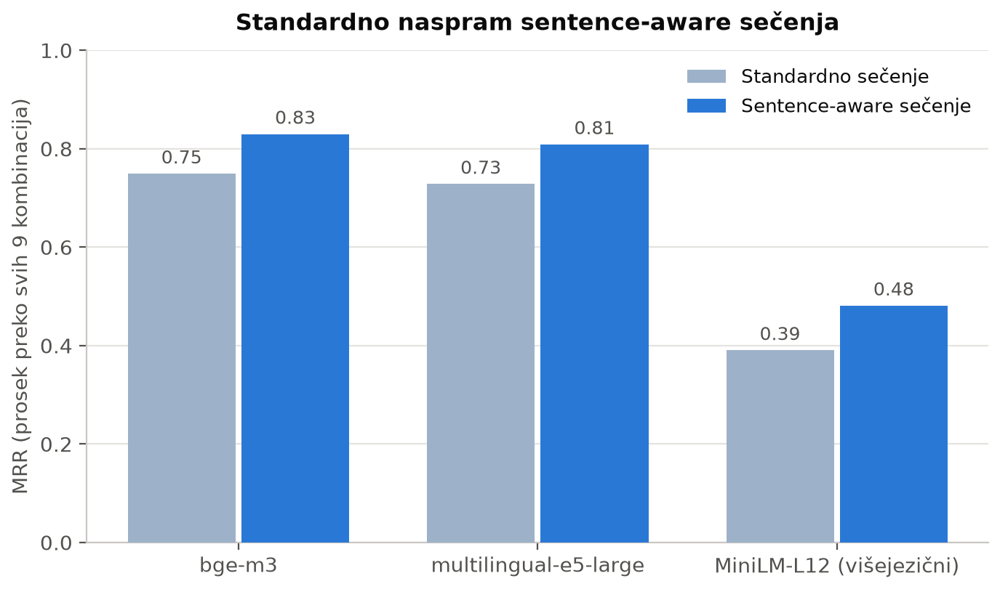

# Retrieval Benchmark for Serbian Legal Documents

Bachelor's thesis project: an experimental study of how to configure the retrieval
stage of a RAG (Retrieval-Augmented Generation) system for legal and academic
regulations written in Serbian, using the [ChromaDB](https://www.trychroma.com/)
vector database.

A user asks a question in Serbian (Latin script), and the system has to find the
passage of a document (Cyrillic script) that contains the answer. The project
measures how retrieval quality and speed depend on the main design choices:

| | Research question | What varies |
|---|---|---|
| **RQ1** | How do the embedding model and the chunking strategy *together* affect retrieval quality? | 4 models × 18 chunking configurations |
| **RQ2** | Does the distance metric matter? | cosine, Euclidean (L2), inner product |
| **RQ3** | How do HNSW index parameters affect quality and speed? | `M` ∈ {8, 16, 32}, `ef_construction` ∈ {100, 200} |

**Best configuration:** `BAAI/bge-m3`, sentence-aware chunking, 512-token chunks
with 10% overlap. **MRR 0.885, Hit@1 83.8%, Hit@5 94.6%.**



## Dataset

**Documents** (`data/`), all publicly available:

| File | Document | Source |
|---|---|---|
| `zakon.pdf` | Law on Higher Education of the Republic of Serbia | official law |
| `praksa.txt` | Rulebook on Professional Practice, ATVSS Niš Department (24 Jun 2024) | [odseknis.akademijanis.edu.rs](https://odseknis.akademijanis.edu.rs/strucna-praksa/) |
| `vannastavne.txt` | Rulebook on Crediting Students' Extracurricular Activities, VTŠ Niš (24 Apr 2017) | [odseknis.akademijanis.edu.rs](https://odseknis.akademijanis.edu.rs/) |

**Test set** (`src/pitanja.py`): 50 hand-written questions.

- **37 answerable questions:** direct, paraphrased and ambiguous ones (e.g. homonyms).
  Each has the exact key phrase of the correct answer taken from the document.
- **13 unanswerable questions:** traps and off-topic questions, where the correct
  behaviour is to find nothing close enough.

A retrieval counts as correct only if the returned chunk **contains the key phrase**,
not merely if it comes from the right document. `src/proveri_fraze.py` checks that
every key phrase really exists in its source document.

## Metrics

- **Hit Rate@k** (k = 1, 3, 5): share of answerable questions whose correct chunk is in the top k.
- **MRR** (Mean Reciprocal Rank): mean of 1 / rank of the first correct chunk (0 if not in the top 5).
- **Latency**: question embedding plus vector search, in milliseconds.
- **Off-topic rejection**: share of unanswerable questions whose nearest chunk is farther
  than a distance threshold of 0.60, i.e. the system "knows it doesn't know".

## Results

### RQ1: embedding model × chunking

Every model was tested with every chunking configuration: 2 strategies (fixed-size
and sentence-aware) × 3 chunk sizes (128, 512, 1024 tokens) × 3 overlaps (0, 10, 20%).

| Model | Best configuration | Hit@1 | Hit@5 | MRR | Mean MRR | Latency |
|---|---|---|---|---|---|---|
| `BAAI/bge-m3` | sentence-aware, 512 / 10% | 83.8% | 94.6% | **0.885** | **0.789** | 91 ms |
| `intfloat/multilingual-e5-large` | fixed-size, 1024 / 20% | 81.1% | 94.6% | 0.867 | 0.768 | 120 ms |
| `paraphrase-multilingual-MiniLM-L12-v2` | sentence-aware, 512 / 20% | 54.0% | 70.3% | 0.584 | 0.436 | 10 ms |
| `all-MiniLM-L6-v2` (English only) | fixed-size, 1024 / 10% | 0.0% | 13.5% | 0.041 | 0.009 | 8 ms |

*Mean MRR is averaged over all 18 chunking configurations.*

Key findings:

- **The best chunk size depends on the model.** 1024 tokens works best for
  multilingual-e5-large and 512 for bge-m3. The small multilingual MiniLM reads only
  the first 128 tokens of its own tokenizer, so most of a large chunk is invisible to
  it and large chunks perform worst. This is why model and chunking were evaluated
  jointly instead of one at a time.
- **Sentence-aware chunking helps every model that understands Serbian.** Closing a
  chunk at a sentence boundary raises mean MRR, e.g. from 0.75 to 0.83 for bge-m3.
- **An English-only model is useless here.** all-MiniLM-L6-v2 scores close to zero
  in every configuration.
- **bge-m3 vs. multilingual-e5-large.** At their best configurations they differ by
  less than one question. bge-m3 was chosen because it is better on average, faster,
  and the only one that rejects off-topic questions: e5 places all distances around
  0.2, so a fixed threshold does not separate relevant from irrelevant results.

| | |
|---|---|
|  |  |

### RQ2: distance metric

Cosine, Euclidean and inner-product search give **identical results** (MRR 0.885).
This is expected: bge-m3 produces unit-length vectors, and for those
‖a − b‖² = 2 − 2·(a·b) and cos(a, b) = a·b, so all three metrics rank results in the
same order. The experiment records the mean vector norm (1.0000) as evidence.

### RQ3: HNSW parameters

All 6 combinations give the same quality (MRR 0.885) and **recall@5 = 1.000** against
exact (brute-force) search. Building the index takes ~200 ms and a vector search
~0.7 ms, so almost all of the query latency (~100 ms) is spent embedding the question.

The collection holds only ~300 vectors and ChromaDB uses `ef_search = 100` by default,
so HNSW effectively performs exact search here. These parameters should only start to
matter on much larger collections.

## Limitations

- **Small test set.** With 37 answerable questions, one question moves Hit Rate by
  ~2.7 percentage points, so differences of a few percent are not significant.
- **Chunk size unit.** Chunk size is measured in tiktoken `cl100k_base` tokens, not in
  the embedding model's own tokens. For Serbian Cyrillic, 512 such tokens are roughly
  210 model tokens.
- **Off-topic threshold.** The 0.60 threshold was chosen from bge-m3 distances and
  does not transfer to other models.
- **Hardware.** Timings were measured on a CPU (AMD Ryzen 5 7600X, no GPU) and depend on
  the machine. Quality metrics do not.

## Future work

This project covers only the retrieval stage. The plan is to extend it into a full
question-answering assistant for students:

- **Answer generation.** Pass the retrieved chunks to a language model that writes
  an answer in Serbian and cites the document and article it comes from.
- **Fine-tuning.** Fine-tune the embedding model on question–passage pairs from
  legal and academic documents, and compare it with the current best model.
- **Better ranking.** Add a reranker and hybrid search (keywords + embeddings).
- **More data.** Add more documents and a larger test set, so that smaller
  differences between configurations can be measured reliably.
- **Conversation.** Support follow-up questions that depend on earlier ones.

## Getting started

Requires Python 3.13.

```bash
git clone https://github.com/Djordje2206/rag-retrieval-benchmark.git
cd rag-retrieval-benchmark
python -m venv .venv
.venv\Scripts\activate          # Windows
# source .venv/bin/activate     # Linux / macOS
pip install -r requirements.txt
python main.py
```

On first run the models are downloaded from Hugging Face (bge-m3 and
multilingual-e5-large are about 2 GB each).

`main.py` opens a menu for running the experiments, generating figures and an
interactive search demo. Every part can also be run directly from the project root:

| Command | What it does | Time (CPU) |
|---|---|---|
| `python src/rq1_modeli_chunking.py` | RQ1, 72 runs; resumes where it stopped if interrupted | ~70 min |
| `python src/rq2_metrike_udaljenosti.py` | RQ2 | ~3 min |
| `python src/rq3_hnsw_parametri.py` | RQ3 | ~3 min |
| `python src/grafici.py` | figures and tables in `rezultati/figures/` | seconds |
| `python src/demo.py` | interactive search with the best configuration | |
| `python src/dijagnostika_po_pitanju.py` | rank of the correct answer for each question | ~2 min |
| `python src/proveri_fraze.py` | checks that every key phrase exists in its document | seconds |

Measurement results are already included in `rezultati/raw/`, so the figures can be
regenerated without rerunning the experiments.

## Project structure

The code, comments and console output are in Serbian, the language of the thesis
and the documents.

```
data/                          source documents
rezultati/raw/                 measurement results (CSV)
rezultati/figures/             figures and tables (PNG)
main.py                        main menu
src/
  dokumenti.py                 document loading
  chunking.py                  fixed-size and sentence-aware chunking, configurations
  modeli.py                    compared models (and the prefixes e5 requires)
  embedding.py                 text embedding
  baza.py                      ChromaDB collection and search
  pitanja.py                   test set
  metrike.py                   Hit Rate, MRR, latency, off-topic rejection
  rezultati.py                 reading and writing CSV results
  rq1_modeli_chunking.py       RQ1
  rq2_metrike_udaljenosti.py   RQ2
  rq3_hnsw_parametri.py        RQ3
  grafici.py                   figures and tables
  demo.py                      interactive search
  dijagnostika_po_pitanju.py   per-question diagnostics
  proveri_fraze.py             test set validation
```

## License

Code is released under the [MIT License](LICENSE). The documents in `data/` are
official public acts and remain the property of their publishers.
